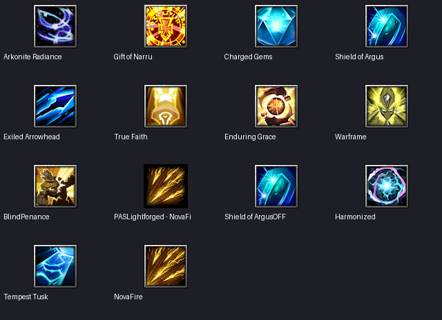
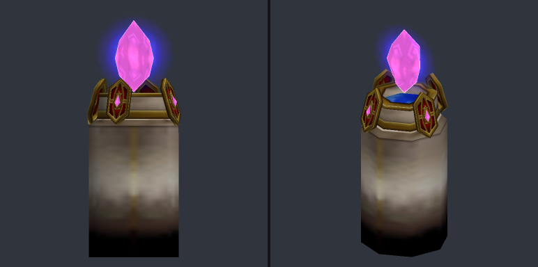
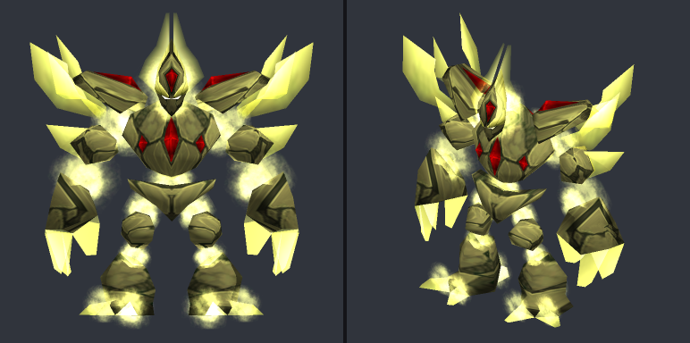

# Дренеи из WL — Bane Burrow v1.63

Анализ 14 октября 2026. Источник — локальный архив `WL - Bane Burrow v1.63.w3x`. Распакованы 10013 файлов в `.cache/wc3/bane-burrow`. Прочитаны object data, WTS и исполняемый `war3map.j`; карта не запускалась. Ниже отдельно обозначены данные источника, выводы и предложения для 23 Race Legion. Игровой код и object data нашей карты этим анализом не изменены.

## Что отличает две расы

| | Exodar Draenei | Lightforged Draenei |
|---|---|---|
| Основа | Арконитовая инфраструктура и боевые заряды | Высокое здоровье и взаимная поддержка |
| Решения игрока | Где поставить источник энергии и когда потратить заряды | Кого лечить, чтобы вернуть усиленное состояние |
| Производство | Отдельная линия механических конструкций | Тяжёлый фронт, лекари и Warframe |
| Слабость по замыслу | Потеря инфраструктуры и истощение зарядов | Потеря бонусов при снижении здоровья |
| Что подходит нам | Кристаллы усиливают конкретные способности | Лечение включает боевые бонусы Озарённых |

Это хорошо дополняет нашу третью линию — Сломленных. Их можно сделать специалистами, которые обеспечивают разведку и удерживают полезность армии вне подготовленной позиции.

## Exodar: подтверждённые механики

### Арконитовая энергия

`A10C Arkonite Radiance`, бафф `B0CG`: поле от главных зданий и инфраструктуры усиливает выбранные способности. В источнике есть самостоятельный Arkonite Conduit `h052` и мобильный Emitter `e01Z/e022`.

Периодический триггер `Draenei Building Inactive Periodic` (`war3map.j:94453`) затемняет здания без поля и для зданий игроков с контроллером USER применяет отключающий эффект через dummy с `A10S`. При восстановлении поля снимает `B0CM`. Это не просто косметическое описание расы, но реализацию нельзя переносить буквально: в ней есть отдельное поведение для человеческого контроллера.

**Для нашей карты:** поле должно ускорять восстановление зарядов и давать специализированные бонусы. Базовое производство, доход, столицы и порталы должны продолжать работать после потери кристалла. Мобильный источник — дорогой T3-специалист с ограничением числа, чтобы не обесценить подготовку позиции.

### Дар Наару как усиление получаемого лечения

`A10Z Gift of Naaru`: бонус к лечению 10%, в поле — 20%. Это пассивное свойство получателя, а не ещё одна кнопка Heal. Триггер `Gift of Naaru` (`94873`) подписан на `udg_HealEvent`; на время дополнительного лечения отключает себя, предотвращая повторное усиление своего же бонуса.

**Ограничение источника:** бонус зависит от прохождения через их систему Heal Unit. Произвольные изменения HP напрямую не обязаны вызвать это событие.

**Для нас:** прежде чем вводить общий коэффициент лечения, собрать все источники лечения дренеев. В первом пакете можно усиливать только конкретные расовые заклинания через единую функцию, не обещая бонус от любого лечения в игре.

### Заряды: три варианта для разных ролей

| Способность / исследование | Поведение источника | Возможная адаптация |
|---|---|---|
| Shield of Argus, `A11J`, `R07F` | Peacekeeper `h04X` имеет до трёх зарядов; обычная атака тратит заряд и уменьшает урон на 50%; в поле заряды восстанавливаются быстрее | Озарённый мечник получает ограниченный щит вместо очередного пассивного множителя |
| Exiled Arrowhead, `A10U`, `R078` | Rangari `h04Y`: до трёх зарядов; атака по юниту расходует заряд и запускает осколки; описание исследования обещает 25 магического урона до трёх соседних целей | Наш `e000` получает осмысленный первый залп; число целей и урон ограничены |
| Tempest Tusks, `A11X`, `R07H` | Elekk Rider `h04V`: заряд расходуется на удар по площади; в поле восстанавливается быстрее, есть дополнительное восстановление от ближних атак | Наш `h01S` получает удар прорыва с ресурсом вместо постоянного бесплатного splash |

Проверены расход и пополнение зарядов в триггерах `Shield of Argus Reduce Damage`, `Shield of Argus Restock`, `Exiled Arrow Effect`, `Exiled Arrow Charge Gained`, `Tempest Tusk Effect`, `Tempest Tusk Charge Gained`. Количество кодируется уровнем способности: уровень 1 означает ноль зарядов, уровень 4 — три. Атаки иллюзий и атаки по зданиям исключаются в проверенных триггерах стрел и бивней.

**Для нас:** хранить заряды в состоянии юнита, показывать их через понятные уровни/описания. Не копировать вспомогательные продаваемые dummy-объекты и весь набор триггеров ради счётчика.

### Рабочие и конструкции

Artificer `h05Q` получает дальнюю боевую возможность от Charged Gems `A10M/A10X`. Периодическая проверка наличия `B0CG` добавляет или удаляет усиление. Это временная оборона работников, а не новая армия без затрат.

Линия механики: Emitter, Siegebreaker, Regulator и Vigilant. Исследования меняют функции:

- `R075 Conquest Aura`: Emitter добавляет осадную составляющую неосадным атакам соседей по описанию исследования.
- `R077 Disarray`: Vigilant нарушает работу зданий и замедляет механические цели.
- `R07D Prismatic Alignment`: улучшает луч Regulator.
- `R07A Harmonized Reconstitution`: расширяет лечение на механические цели.

Anchorite `h04S` использует Reconstitute `A11C`. В триггере (`95464`) соседние цели в радиусе 150 получают **5 HP**, хотя описание говорит **4 HP**. Дополнительное лечение идёт через прямой `SetUnitState`, что также важно при анализе Gift of Naaru.

**Для нас:** начать с одного конструкта поддержки, а не переносить четыре новые линии производства. Исследование для лечения механизмов даёт интересное изменение состава армии. Саботаж ограничить боевыми башнями, не отключать столицы и общие системы карты.

## Lightforged: подтверждённые механики

### Здоровье как боевой ресурс

Fortitude — название идеи в меню расы, а не одна универсальная способность. Несколько разных способностей проверяют порог **80% HP**:

- `A0XW Flare Shard`: Brightlance получает дополнительный урон по описанию.
- `A0YE/A0YD Living Precision`: Sagittary получает критический удар; добавление/удаление бонуса по порогу подтверждено в периодическом триггере (`98492`).
- `A0YC Lightspeed`: Wayfinder получает скорость.
- `A0YL Rapturous`: бонус восстановления маны для заклинателей.
- `A0Y9 Lambent Warrior`: Partisan получает магическую неуязвимость по описанию.
- `A0XF Benediction`: Felcrusher имеет усиленный splash и защиту при высоком здоровье.

`A0Y7 Inviolable Arrows`, исследование `R07T`: отдельная механика без порога — бонус атаки равен **3% текущего HP** Sagittary. Формула подтверждена в триггере `Inviolable Arrows`.

**Для нас:** применить порог к двум-трём Озарённым, а не ко всему составу. Для прототипа включать бонус при 85% HP, выключать ниже 75%: разница порогов предотвращает мерцание состояния при каждом ударе и лечении. Дать небольшой фиксированный бонус атаки/защиты; постоянная магическая неуязвимость и масштабирование урона от абсолютного HP для нашей карты слишком сильно связаны с другими улучшениями и предметами.

### Лечение включает защиту

Centurion `h05N`, `A0XT Dedicate`: атаки дают временную броню и регенерацию; исследование `R07Z True Faith` позволяет активировать состояние от лечения. Наличие отдельных триггеров `Dedicate Activate Damage` и `Dedicate Activate Heal` подтверждает два события активации.

**Для нас:** «Обет стойкости» паладина или мечника: после существенного лечения кратко усиливает собственную защиту. Минимальная величина реального лечения и внутренний cooldown исключают бесконечное обновление от тиков по 1 HP. Повторное лечение обновляет длительность в пределах лимита, не складывает броню.

### Разные способы восстановления

- Lightbearer `h05R`, Binding Glow `A0XK`: стационарная поддержка лечением. **Есть несоответствие:** описание говорит 5 маны на цель; проверенный триггер `Binding Glow Pulse` списывает фиксированные 20 маны за импульс, лечит подходящих союзников в радиусе 450 на 15/20 HP и проверяет `R00C`, тогда как расовое исследование усиления называется `R07K`. Нельзя переносить это как готовую проверенную систему.
- Matrix Crystal `h064`, `A0XN Blessed Vigil`: описание связывает атаки с лечением ближайшего раненого союзника.
- Warframe `h05W`, `A0YP Retributive Core`: полученный урон преобразуется в распределённое лечение соседей. В триггере урон берётся из `udg_DamageEventPrevAmt`, делится между раненными союзниками в радиусе 450; есть cooldown **0,5 секунды**. Сам Warframe и здания исключаются, деление на ноль обработано.
- `A0Y4 Heaven's Restraint`: ослабление урона противника и его лечения по описанию. Это полезный способ противодействовать другой лечебной армии.

**Для нас:** Warframe адаптировать как «Ядро милосердия»: часть фактически полученного вражеского урона превращается в общий ограниченный бюджет лечения. Не лечить на 100% урона до брони; исключить союзный урон, самоурон, отражения и рекурсивные события. Ограничить число целей и лечение за секунду.

### Рабочие и укрепление базы

Scintilla `e025` — летающий рабочий. Bestow Incandescence `A0XJ`: до трёх рабочих прикрепляются к главному зданию, усиливая его защиту и восстановление. Подтверждены данные worker docking и триггеры Incandescence. В проверенном T1-обработчике здание получает **1,5 HP/с на уровень прикрепления**, а также боевую способность соответствующего уровня. Высокое здоровье главного здания даёт дополнительную зону урона по описанию `A0Y5`.

**Для нас:** сохранить инженера наземным. Адаптировать выбор «рабочий добывает или обслуживает кристалл»: инженер каналом заряжает маяк, прекращая обычную работу. Летающий сборщик дерева сильно меняет ограничения рельефа и безопасность экономики на нашей карте.

## Предлагаемая система для 23 Race Legion

Общее направление: **подготовка Exodar + стойкость Озарённых + самостоятельность Сломленных**. Кристаллы и здоровье служат разными ресурсами; нет необходимости создавать две новые полноценные расы.

### Первый пакет: «Арконитовые обеты»

1. **Кристалл резонанса на T2.** Главное здание создаёт небольшую исходную зону, дополнительно доступны два маяка. Поле не складывается и действует только на собственные подходящие юниты. Вне поля способности остаются работоспособными.
2. **Рангари: Призматический залп.** Два заряда; атака по вражескому юниту расходует один и поражает максимум две дополнительные цели. Первоначальный ориентир: восстановление 18 секунд вне поля / 12 внутри; значения проверить по нашему темпу боя.
3. **Мечник: Щит Аргуса.** Два заряда; обычная вражеская атака расходует один и получает ограниченное снижение урона. Не вводить этот бонус поверх всех текущих множителей защиты без пересмотра бюджета юнита.
4. **Жрица: Обет Света.** Существенное лечение раненого Озарённого даёт короткий защитный бонус, внутри поля — более долгий. Способность связывает лекаря с фронтом без нового общего множителя лечения.
5. **Инженер: Настройка кристалла.** Временно отказывается от добычи/ремонта ради ускоренного восстановления маяка. Не превращается в постоянного бесплатного дальнего бойца.

Это заменяет более расплывчатую идею универсального усиливающего импульса из [первого проекта](DRAENEI_REWORK_DESIGN.md) конкретной системой зарядов. Восстанавливающий импульс маяка можно сохранить с отдельной стоимостью и лимитом целей, если он не дублирует лазарет.

### Следующий пакет

- **Элекк: Удар кристаллических бивней.** Один подготовленный удар по площади; восстановление быстрее у маяка. Отдаёт полезность в первом столкновении, затем требует перегруппировки.
- **Конструкт «Хранитель Наару».** Один новый дорогой T3-юнит с Ядром милосердия; отдельное исследование разрешает жрецу лечить механизмы. Вначале лимит два на игрока, затем игровой баланс.
- **Озарённые: Совершенный строй.** Два выбранных юнита получают устойчивое состояние высокого HP с разными бонусами. Жрица помогает вернуть состояние, а не только оттягивает смерть.
- **Сломленные: Полевые осколки.** Провидец создаёт временную точку, которая ускоряет восстановление зарядов слабее стационарного маяка, без лечения и без усиления дохода. Сильные и слабые поля не складываются; ограничены длительность и число точек.
- **Лазутчик: Нарушение резонанса.** Краткая метка на вражеской боевой поддержке снижает её расовый лечебный бонус, не отменяя все ауры противника. Предлагаемая уникальная механика нашей карты, в источнике её нет.

### Исследования должны менять решения

| Название для нас | Что открывает | Вдохновение |
|---|---|---|
| Арконитовая настройка | Маяки и ускоренное восстановление зарядов | Arkonite Radiance |
| Призматические наконечники | Заряды залпа рангари | Exiled Arrowhead |
| Кристаллический заслон | Заряды щита мечника | Shield of Argus |
| Согласованное восстановление | Жрец может лечить собственные механизмы | Harmonized Reconstitution |
| Обет стойкости | Существенное лечение кратко укрепляет фронт | True Faith |
| Полевой резонанс | Временная слабая опорная точка Сломленных | Новая адаптация для нашей карты |

Не добавлять всё поверх текущих способностей. У наших жрицы уже есть лечение волной, паладина — Свет, ауры и воскрешение, рангари — особые стрелы. Сначала выбрать, какой существующий эффект заменяется, и обновить соответствующие исследования и подсказки.

## Ассеты: что подготовлено

Кандидаты извлечены в `.cache/wc3/bane-analysis/candidate-assets/` с сохранением путей. Набор: **26 основных кандидатов, 51 файл вместе с найденными портретами, текстурами и disabled-иконками; 4 086 197 байт**. Это подборка для будущего импорта, не запись в `map.w3x`.

Полные пути, SHA256, размеры, связи с текстурами и архив-источник — [asset-candidates.json](bane_draenei/asset-candidates.json). Все 66 внешних ссылок на текстуры найдены командой HiveWE `asset-exists`; результаты — [texture-checks.json](bane_draenei/texture-checks.json). Модельный просмотрщик иногда находит текстуры в соседних проектах: именно поэтому наличие отдельно проверялось в Warcraft, а результат preview не считался доказательством комплектности.

### Иконки

Особенно подходят Arkonite Radiance, Charged Gems, Shield of Argus, Exiled Arrowhead, Harmonized, True Faith и Enduring Grace. У выбранных файлов проверить наличие disabled-пары по манифесту; использовать точный исходный путь, поскольку имена отдельных иконок отличаются от названия способности. Некоторые иконки в подборке относятся к техническим состояниям: не делать их отдельными исследованиями без смысла для игрока.

### Модели

| Файл | Предлагаемая роль | Что проверено |
|---|---|---|
| `Exodar Draenei - DraeneiArcaneGenerator.mdx` | Стационарный маяк | MDX v800, 1688 треугольников, 6 последовательностей; ошибок парсера нет, 7 предупреждений геометрии |
| `Exodar Draenei - Emitter.mdx` | Дорогой мобильный источник | Файл и зависимости извлечены; игровая проверка предстоит |
| `Exodar Draenei - Draenei_Vigilant.mdx` | Альтернативный кристаллический конструкт | Файл и зависимости извлечены; игровая проверка предстоит |
| `Lightforged - DivineGolem.mdx` | Хранитель Наару | MDX v800, 2306 треугольников, 16 последовательностей; ошибок и предупреждений парсера нет |
| `Lightforged - Crystal.mdx` | Вариант светового маяка | Файл и зависимости извлечены; игровая проверка предстоит |
| `Lightforged - LightbornePriest_V1.mdx` | Жрица/жрец Озарённых | Файл и зависимости извлечены; игровая проверка предстоит |

Превью статические, без полноценной проверки анимации, частиц и звуков. Тёмная часть основания генератора требует просмотра в игре: по этому рендеру не делать вывод о дефекте модели. Не заменять существующие модели только потому, что появилась новая; сначала оценить силуэт, масштаб, стоимость частиц, портрет и размер импорта.

Имя модели Divine Golem содержит атрибуцию **Villagerino**. Для переноса сохранять происхождение файлов и найденную атрибуцию; полный список авторов остальных ресурсов по этому анализу не установлен.

### Эффекты

- `Exodar Draenei - Reconstitute.mdx`: короткий эффект лечения, в источнике используется создание и немедленный DestroyEffect.
- `Exodar Draenei - Crest of Protection.mdx`: обозначение защитной области.
- `Lightforged - GlowShield026.mdx`: усиленное/защитное состояние.
- `Lightforged - Echo of Brilliance.mdx`: видимый разведывательный/контрольный объект.
- `Lightforged - Runical-Holy Aura.mdx`: сдержанное обозначение Света после оценки масштаба и частиц.
- `Exodar Draenei - Nether Arrow.mdx`: кристаллический снаряд.

Не все эти модели подходят для немедленного удаления: короткий импульс и длительная аура требуют разных жизненных циклов. Проверить Birth/Stand/Death и визуальный результат в Warcraft.

## Что не переносить буквально

- Отключение всей экономики при разрушении источника энергии.
- Все проценты, времена контроля и количество массовых целей: источник рассчитан на другую экономику и размер армий.
- Постоянную магическую неуязвимость от высокого HP и урон, неограниченно растущий от максимального здоровья через предметы.
- Лечение Warframe на полный урон до брони, усиление любого лечения через рекурсивные события, бесконтрольное суммирование аур союзников.
- Летающих рабочих без отдельной проверки добычи, маршрутов, рельефа и AI.
- JASS-фреймворки HealEvent, worker docking и damage engine как самостоятельные параллельные подсистемы: интегрировать нужное поведение в наши текущие системы.
- Донорские rawcode: они конфликтуют с нашей картой. Например, `h05C` у нас — лазарет, у источника — Upholder; `A0Z3` у нас — строительный маркер, у источника — геройский Seraphic Sentinel.

## Следующий этап реализации

Первый конкретный пакет — маяк, два типа зарядов, одно взаимодействие лечения с защитой, шесть функциональных исследований и AI, который этим пользуется. Каждую способность вводить после сопоставления с текущими бонусами юнита. Полевые точки, HP-состояния и конструкт — последующие отдельные этапы.

Проверки: исследования и их требования, два одновременных здания, смена владельца, смерть/отмена, иллюзии, союзный урон, здоровье на границе состояния, вход/выход из поля, отсутствие удвоения бонусов и очистка handles. Затем игровые сравнения равных по стоимости армий и массовый бой с несколькими дренейскими игроками. У всех активных способностей должны быть правила AI; расовое развитие должно исследоваться ботом.

Полные извлечённые данные: [races.json](bane_draenei/races.json), [выдержки триггеров](bane_draenei/mechanics.j), [способности нашей расы](bane_draenei/our-abilities.json). В races.json есть игровые юниты, альтернативные формы, вспомогательные объекты и технические способности; их число не равно размеру доступного игроку состава.
