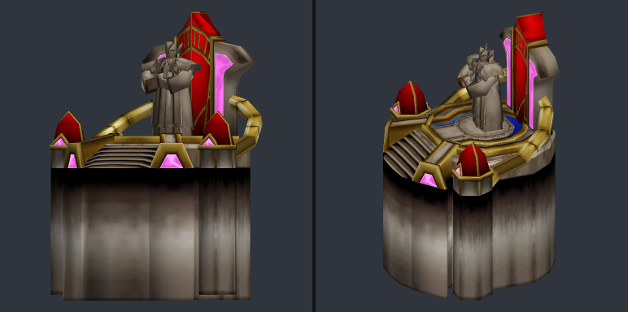
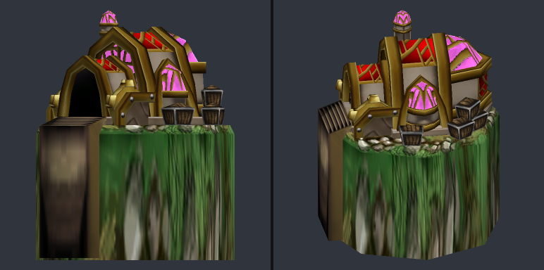
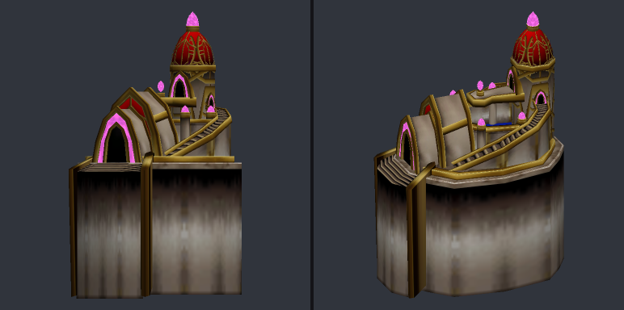
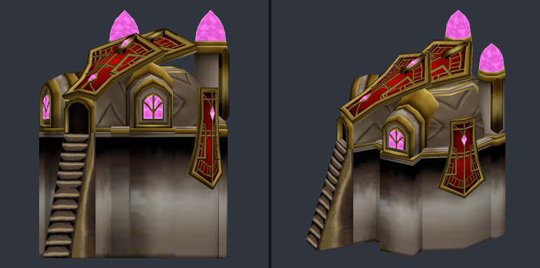

# Дренеи: здания, панель провидца и подсказки ресурсов

Обновление 14 октября 2026. Применено к `map.w3x`, Lua пересобран.

| Объект нашей карты | Новая модель из Bane Burrow | Масштаб |
|---|---|---|
| `h057`, **Алтарь Наару** | Exodar Draenei — DraeneiAltar, донор `h053` | 1,00 |
| `h055`, Мастерская | Exodar Draenei — DraeneiWorkshopV1, донор `h057` | 0,65 |
| `h056`, Чародейский кластер | Exodar Draenei — DraeneiTemple / Hall of Prophecy, донор `h058` | 0,75 |
| `h033`, **Казармы Аргуса**, T1 | Exodar Draenei — DraeneiBarracks / Casern, донор `h055` | 1,00 |

У всех четырёх заменены иконки, импортированы disabled-пары и общая текстура `DraeneiBuilding1.blp`. Всего 13 файлов. Модели копируются без редактирования MDX. Масштаб подобран по габаритам видимой геометрии в Stand относительно прежних зданий. Коллизии, pathing-текстуры, строительство, исследования и обучение сохраняются. У алтаря и казарм обновлены названия и подписи строительных кнопок.

Четыре старые модели удалены после поиска ссылок по всей распакованной карте, включая бинарные object/GUI/model data, исходники Lua и UTF-16-строки. Удалены также пять неиспользуемых старых иконок. Общая `BTNdbase2.blp` сохранена для Бастиона `h017`, вместе с её неявно загружаемой disabled-парой. Резервные копии удалённого лежат в `.cache/wc3/draenei-buildings/removed-assets/`.

## Сломленный провидец

- Аура **Мудрость Предков** `A064` удалена из способностей `n005`.
- **Идол памяти** `ADr5` занимает её позицию: четвёртая кнопка нижнего ряда, клавиша **E**.
- **Щит молний** `A063` получает клавишу **L**, чтобы освободить E.
- **Поле слома** `A1C8` перенесено во вторую кнопку нижнего ряда; клавиша **R** сохранена. Прежнее пересечение позиций с аурой устранено.
- Модель самого идола остаётся исходной Healing Ward. Исследование Память предков и механика идола сохраняются.

## Подсказки дохода и государства

В `60_income_tooltip.lua` фиксированная высота заменена измерением текста. Текст имеет заданную ширину и автоматическую высоту; нижняя привязка из FDF снимается. Фон получает высоту текста плюс верхний отступ для заголовка и небольшой нижний отступ.

Размер пересчитывается при обновлении содержимого: подсказка растёт при переносе длинного названия столицы и уменьшается при сокращении текста. Изменения относятся только к локальному интерфейсу и не влияют на экономику или синхронизацию.

## Проверки

- 80 regression-тестов прошли, включая изменение высоты подсказок, длинные строки, панель провидца и сохранение disabled-иконки общего ресурса.
- Синтаксис Lua, совпадение исходников со сборкой и валидатор AI прошли; у AI остаются прежние 72 предупреждения без ошибок.
- Новые модели прочитаны MDLxL без ошибок; в исходных моделях есть предупреждения о повторяющихся вершинах. Есть Stand, Stand Work, Birth, Death и Decay. Подготовлены статические превью; стандартные текстуры проверены через Warcraft, локальная зависимость импортирована.
- Object validation: 25 ошибок до и 25 после, новых нет. Полный HiveWE semantic diff завершился с ACCESS_VIOLATION; вместо него проверен структурный diff бинарных записей. Посторонние записи и нецелевые поля сохранены побайтно.
- Live bridge не ответил на проверочный запрос; в текущей игровой сессии изменения интерфейса и моделей не проверялись. Для загрузки новых импортов нужен запуск обновлённой карты.

Сборка для запуска: `.cache/wc3/draenei-buildings/23_race_draenei_visual_update.w3x`.

Данные изменений: [replacement.json](draenei_visual_update/replacement.json), [структурный diff](draenei_visual_update/raw-object-diff.json), [валидация ссылок](draenei_visual_update/validation-delta.json).

